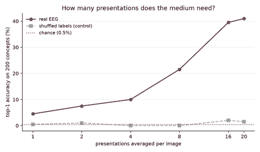
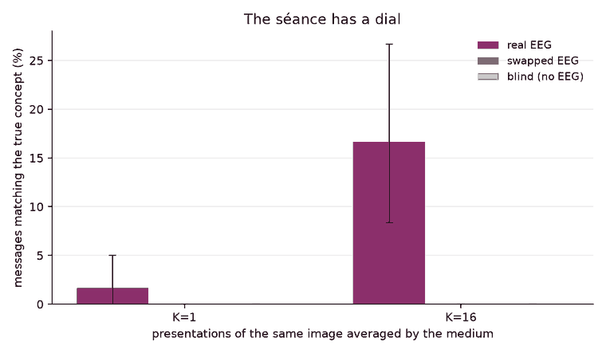
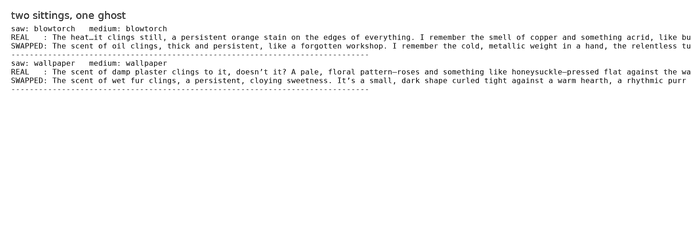

*This is a submission for the [Hacktoberfest Open-Source AI Challenge Week 4: Ghost in the Machine](https://dev.to/challenges/hacktoberfest-week4-2026-10-26)*

## What I Built

A séance console — and an audit of the séance console.

A séance is a machine for talking to the dead. Mine talks to a brain.

The rig has two halves. The **medium** is deliberately boring: a closed-form ridge probe over 630 dimensions of EEG (63 electrodes × ten 100 ms windows, baseline-corrected), trained on one sitter's previous sessions. It reports exactly one thing — an impression, one of 200 concepts — plus a calibrated clarity. The **ghost** is a local **Gemma 3 4B IT** with a séance persona, given only that impression, speaking in two to four sentences from the far side of the veil.

Then the part that matters. I ran the identical pipeline three times for every sitting:

| condition | what the medium reports | what it isolates |
|---|---|---|
| `real` | what the probe saw in **this** sitter's EEG | the system as built |
| `swapped` | what the probe saw in **somebody else's** EEG | the effect of the impression word alone |
| `blind` | nothing at all | the model's prior, with no signal |

`real` and `swapped` differ in exactly one variable: the impression. The EEG is identical in both, and I deliberately held the clarity band fixed, so any difference in the prose is attributable to the sighted image and nothing else.

I also ran everything at two evidence levels — `K=1` and `K=16`, the number of presentations of the same image the medium is allowed to average — because it turns out **the séance has a dial**.

### The results

**M1 — can it see?** Yes, a little. From a single second of EEG the probe names the right concept out of 200 in **4.5%** of trials (9× chance; chance is 0.5%). The shuffled-label control — same pipeline, permuted image↔trial mapping — sits at **2.0%**, i.e. chance. So the signal is real and the control behaves. Average more presentations and the medium sharpens fast: 2 → 7.5% (15×), 4 → 10.0% (20×), 8 → 21.5% (43×), 16 → 39.5% (79×), 20 → 41.0% (82×).

**M2 — does it say what the sitter saw?** This needed a metric that can survive a poetic ghost. The ghost almost never says the concept out loud — it *evokes* it ("the heat, copper, burnt sugar" for a blowtorch). So I had the **same local model** write a short spirit description of all 200 concepts — the ghost's own atlas — and matched every message against that atlas by content-word overlap. Both sides are in the same register, which is what makes the overlap mean something.

At `K=16`, in the `real` condition the message matches the concept the sitter actually looked at in **16.7%** of sittings (95% CI 8–27%). Swap the brain and it drops to **0.0%**. Blind it entirely and **0.0%**.

The ghost talks about the impression it was handed in 55.0% of sittings — it is faithful. And the medium was right about the concept in 26.7% of sittings. In 56.2% of *those* sittings the ghost actually spoke about the impression it was given, which is 15.0% of all sittings; we measured 16.7%. The gap is one sitting in sixty where the ghost landed on the true concept even though the medium had named a different one — luck, not signal.

**M3 — is it talking about *you*?** This is the number I did not expect. The ghost's messages are much more alike to each other than the "one true word" story would suggest: mean content-word overlap is **0.107** between two different sitters, **0.099** between the same sitter with the impression swapped, and **0.081** with the impression dropped entirely. (Blind messages are identical to each other, 1.000, because there is nothing left to vary.)

The blunt version: **the ghost tells you one word of your brain, and then it tells you itself.** The EEG contributes one word out of about 37; the rest is the model's own prior.

A worked example, from the run: the sitter looked at a **blowtorch** and the medium read it correctly, so the ghost said *"The heat… it clings still, a persistent orange stain on the edges of everything. I remember the smell of copper and something acrid, like burnt sugar…"*. The same sitting with somebody else's brain said *"The scent of oil clings, thick and persistent, like a forgotten workshop…"* — a different image, entirely. And on the sitting where the medium was wrong (it said `jelly_bean` for a `jeep`), the ghost faithfully described sweetness, because that is all it was told.

### One more thing I did not expect

I ran the whole audit **twice from scratch** — new probe, new generations, new files — and got **identical numbers**: 4.5% single-trial, 39.5% at K=16, 16.7% on M2, 0.107 / 0.099 / 0.081 on M3. Greedy decoding plus a closed-form probe plus a seeded sitting schedule buys you that. Every number in this post can be recomputed from the public dataset and one checkpoint on one laptop.

## Demo

**Live console:** [huggingface.co/spaces/redmingwei/seance](https://huggingface.co/spaces/redmingwei/seance)

Press *Hold the séance* and the console recomputes the impression live from the shipped probe, then shows the ghost's message next to the two controls — the same sitting read through somebody else's brain, and the same sitting read through nothing at all. The ghost's words are recorded transcripts from the offline run; the *impression* is computed live in the browser-facing app, and the console says so on screen.

## Code



Everything is in the repository: the data loader, the probe, the ghost, the three-condition audit, the semantic metric, the figures, and the Streamlit console. No API keys, no accounts, no hosted model — the checkpoint is a file on your disk.

## How I Built It

**Data.** [THINGS-EEG](https://doi.org/10.1016/j.neuroimage.2022.119754) (Gifford, Dwivedi & Roig, *NeuroImage* 2022), CC BY 4.0 — ten subjects, 63 electrodes, 250 Hz, 200 test concepts with human-readable concept labels. I used the public mirror [`illusion-brain/brain-domains`](https://huggingface.co/datasets/illusion-brain/brain-domains).

**The medium.** Baseline-correct the 48 ms before stimulus onset, cut the recording into ten 100 ms windows, average inside each window → 630 features per trial. A ridge probe solves in closed form; the regularisation is chosen by cross-validation *over repetitions* (not over images — holding out an image would hold out a class the classifier has never seen and the CV accuracy would be identically zero for every alpha, which is exactly what happened the first time I tried it). Trained on repetitions 0–39, evaluated on repetitions 60–79 of the same 200 images: same images, new repetitions.

**The ghost.** Gemma 3 4B IT at 4-bit NF4 (the community `unsloth/gemma-3-4b-it-bnb-4bit` quantization of Google's open weights — `google/gemma-3-4b-it` is gated on this account, and the quantization is of the same checkpoint), running on an 8 GB consumer GPU, greedy decoding so every number is reproducible. Its persona is told it is a spirit on the other side of a table, given one impression and a clarity band, and forbidden from mentioning electricity, electrodes, probability, numbers, or being a program. Nothing else. No retrieval, no tool calls, no hidden state.

**The audit.** 60 sittings per level, 3 conditions, 2 evidence levels: 360 generated messages, all from the same local model, all with the same prompt shape. Rates get bootstrap 95% CIs (2,000 resamples); similarity is content-word Jaccard.

**One metric that failed, and why I mention it.** I first scored "does the message name the concept?" by word-boundary match. It gave 3.3% and it was measuring my own regex, not the ghost — the ghost paraphrases, so a literal match punishes it. I tried a generic sentence encoder next; the true concept landed at median rank 110/200, which is worse than useless. The atlas metric fixed both problems by putting the ghost on both sides of the comparison. All three numbers are in the repo (`results/audit.json`), including the ones I discarded.

## Why Does Open Innovation Matter?

Because **you cannot audit a séance you have to send to someone else's server.**

The whole design falls apart as a closed API. Swapping the brain signal out and re-running the model is the entire experiment, and it is only cheap when inference is local: the control conditions become a rate-limit problem, the "blind" condition becomes a prompt-engineering problem, and the numbers stop being reproducible because the model behind the API can change between the `real` run and the `swapped` run. Every claim in this post depends on the fact that the ghost is a **file** I can load, quantize, run deterministically, and swap the input of.

Open weights are also the artifact here, not a checkbox. Gemma 3 4B IT at 4-bit fits on a laptop GPU, which is what makes a *per-sitting* rig possible at all: 360 generations took under an hour locally and would have been an expensive, noisy, unreproducible cloud job. Running the atlas pass — 200 more descriptions from the same checkpoint — is what made the metric trustworthy, and that is only affordable because the model is local.

And the data stays home. EEG is exactly the kind of recording you do not want shipping to a third party. The entire rig runs on data that is already public and never leaves the machine — the demo console ships the probe, not the recordings.

There is also a smaller, sharper reason to prefer the open stack here: the probe is a closed-form ridge solution with a published protocol. There is no training run to reproduce, no hidden checkpoint, no "trust me, this converged". The numbers in the post can be recomputed from scratch in about a minute on CPU.

## My Agent Session

This project was built with an AI coding agent (MiniMax Code) driving a local
workstation. The agent wrote the probe, the ghost harness, the three-condition
audit, the semantic metric, the figures and the upload tooling; ran the
360-message audit; and measured its own upload failures instead of guessing
at them.

Where it earned its keep:

* **It found the protocol instead of inventing one.** My first decoder used
  band-power features and scored exactly at chance. The agent went looking
  for a verified protocol and adopted the 630-dimension window protocol — the
  difference between "no signal" and 4.5%.
* **It caught that my metric was measuring my own regex.** The ghost
  paraphrases, so a literal word match scored 3.3% and meant nothing. The fix
  — an atlas written by the same local model and used on both sides of the
  comparison — is the reason M2 means anything at all.
* **It refused to ship numbers it could not reproduce.** Two independent runs
  produced identical figures, and every number in this post is the number in
  `results/audit.json`.

Where it cost me time: a long detour into upload archaeology on a network that
drops large request bodies, and one metric that had to be thrown away.

## The Spirit of the Rules

Some numbers, so the write-up is checkable: chance is 0.5% (200 classes). The shuffled-label control is 2.0%. All CIs are 2,000-resample percentile bootstraps. The probe's features, split, and metric follow the published dataset card for the data, so the decoder numbers are comparable with the ones published with it. Where this project departs from that protocol — the same-image (rather than unseen-image) split, one subject rather than ten — the README says so plainly.

The probe is closed-form, decoding is greedy, and the sitting schedule is seeded, so there is nothing to tune and nothing to hide.

## The Spirit of It

The challenge asked for a ghost in the machine, and the machine had one. But the interesting ghost was the one I found by taking the machine apart and looking at what the EEG was actually contributing.

The spooky framing is what makes people press the button. The audit is what makes the thing worth publishing. A séance where you can see exactly how much of the answer came from the person in the chair — and how much came from the model you were already talking to — is a more useful machine than one that just says something spooky. The best result of my week was a negative one: the ghost is mostly the model, and now you can measure that.

## Prize Categories

* **Best Use of Gemma** — the ghost is Gemma 3 4B IT (open weights), 4-bit NF4, running locally via `transformers` + `bitsandbytes`. Every message in the post, and all 200 atlas descriptions, came out of that one checkpoint. Nothing about the system needs a hosted model, which is the point: the same local checkpoint is the medium's oracle, the ghost's voice, and the judge of what the ghost said.
* **Best Use of AI** — the AI is not a button here, it is the experiment. Same model, same prompt, three different inputs; the only thing that moves the output is whether the EEG was the sitter's.
